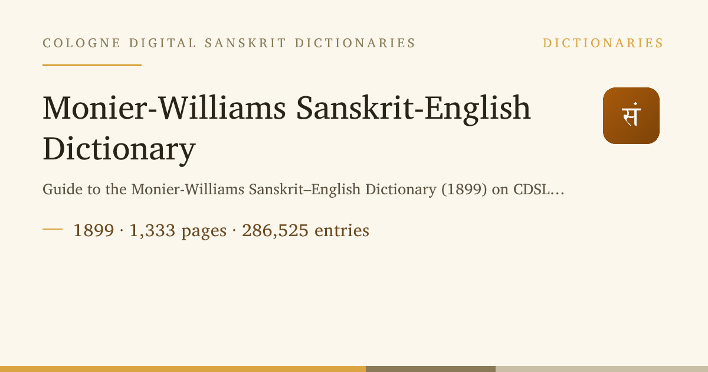
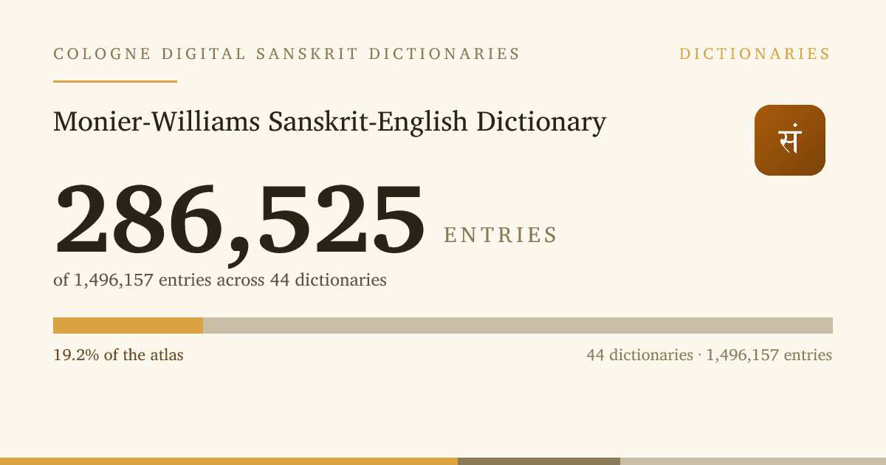
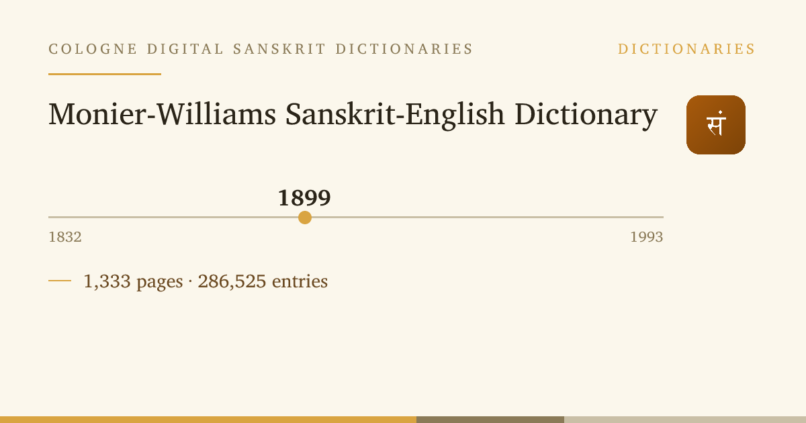
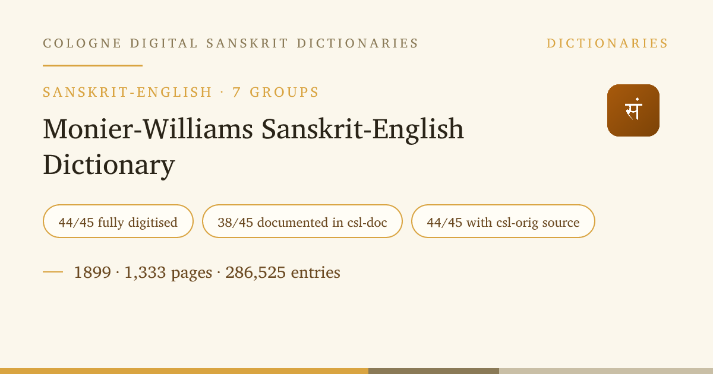

# H7931 — four v4 layouts on real dictionary data

_Created: 09-11-2026 · Last updated: 09-11-2026_

All four cards are 1200×630 PNGs rendered by `scripts/og-card-v4/render-layouts.mjs`
through satori → `@resvg/resvg-js`, the same pipeline as the production plugin.
Every value on them comes from `src/data/dictionaries.json` and
`src/data/atlas-extract.json` via `scripts/og-card-v4/card-data.mjs`; the
resolved object, the data row and the SHA-256 of each PNG are in
[`card-data.json`](card-data.json). No lorem, no hand-typed number, no
placeholder. The four cards are the Monier-Williams guide page (`MW`), the
flagship dictionary; the same script renders any catalogued code with
`--code`.

The three fields MG asked for are on every layout: **year**, **pages**,
**entries**. The `29 posts` stat is on none of them.

## A — Library label



**Data row:** `1899 · 1,333 pages · 286,525 entries` — `dictionaries.json`
`year`/`pages`, `atlas-extract.json` `dicts.mw.entries`.

**Rationale:** v3's composition, with the three fields as one bibliographic
line under the title — the card still reads as a page identifier first, and
the row is the same shape a library catalogue uses.

## B — Scale



**Data row:** hero `286,525` entries, `of 1,496,157 entries across 44
dictionaries`, bar at `19.2% of the atlas` — MW's atlas row over the whole
atlas total.

**Rationale:** makes the dictionary's size the hook and pays for the claim with
a printed denominator and a comparison bar rather than a naked number.

## C — Timeline



**Data row:** `1899` placed on the catalog's real `1832–1993` span; secondary
`1,333 pages · 286,525 entries` — all 45 catalog years, min/max computed.

**Rationale:** the edition sits in the library's history; the year is the
loudest object and the span is a fact no other card in the estate can show.

## D — Atlas



**Data row:** group kicker `Sanskrit-English · 7 groups`; badges `44/45 fully
digitised`, `38/45 documented in csl-doc`, `44/45 with csl-orig source`;
secondary `1899 · 1,333 pages · 286,525 entries` — feed flags with their
denominators.

**Rationale:** states the digital product promise (digitised, documented, with
source) instead of another count of words; the badges are the card's content.

## Recommendation: A (library label)

**What it costs:** one line in `renderCard.js` plus the per-page data
resolution in `plugins/og-cards/index.js`, and a re-baselined golden card
(`node scripts/check-og-cards.mjs --write-golden`) in the implementation PR.
The pixel gate is not bypassed — it is re-frozen with a visible diff.

**What it loses:** the entry count is not loud (B), the edition is not placed
in history (C), and the digitisation promise is not on the card (D). A is also
the least surprising of the four: it is v3 plus the row MG asked for, so it
wins on page-type coverage and loses on drama. The other three are better
one-page stories and worse system defaults — they only make sense on the ~45
dictionary pages, while A also degrades cleanly on the other ~110 guide pages
(no row) and gives the home card a site aggregate.

The full trade-off, alternatives and consequences are in
[`docs/internal/adr/0001-og-card-v4-layout.md`](../../adr/0001-og-card-v4-layout.md).

## Reproduce

```sh
node scripts/og-card-v4/render-layouts.mjs            # four PNGs + card-data.json
node scripts/og-card-v4/render-v3-live.mjs            # the live v3 comparison card
```

Both scripts read only committed feeds and the vendored Charis fonts / site
mark; neither touches `plugins/og-cards/*`, `deploy.yml` or the golden fixture.
